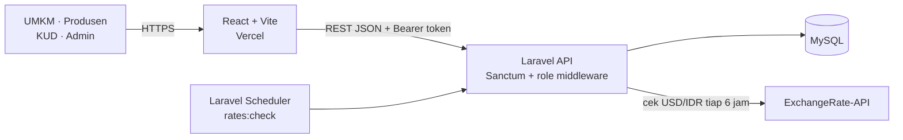

# LokalChain

**Rekomendasi pemasok bahan baku lokal terdekat dan termurah untuk UMKM, lengkap dengan pemantauan kurs USD/IDR dan mode krisis otomatis.**

[](https://laravel.com)
[](https://react.dev)
[](https://www.mysql.com)
[](https://vercel.com)
[](https://railway.app)

**Demo live:** [URL Vercel — isi setelah deploy] · **Repositori:** [agnigaluhev-svg/lokalchain-api](https://github.com/agnigaluhev-svg/lokalchain-api)

> Proyek ini dibuat untuk **NSEC 2026**. Fokusnya bukan menambah fitur sebanyak mungkin, tetapi menyelesaikan satu masalah nyata UMKM dengan alur data yang jelas dan pembatasan akses yang ditegakkan di server.

---

## Masalah yang diselesaikan

Banyak UMKM pangan masih bergantung pada bahan baku impor. Saat rupiah melemah, harga bahan baku ikut naik, sementara mencari pemasok lokal yang benar-benar tersedia, terdekat, dan murah biasanya dilakukan manual lewat telepon, grup chat, atau kunjungan lapangan.

LokalChain mempertemukan UMKM dengan produsen lokal yang sudah divalidasi KUD, menghitung perkiraan biaya pengadaan, dan memberi peringatan ketika kurs bergerak melewati ambang krisis.

### Cara kerjanya

1. UMKM memilih komoditas, jumlah kebutuhan, dan lokasinya.
2. API mengambil produsen **tervalidasi** yang menjual komoditas tersebut.
3. Jarak dihitung dengan **Haversine**, lalu kandidat diurutkan berdasarkan **total biaya** (harga barang + estimasi ongkos jarak).
4. UMKM melihat peringkat pemasok, peta skematik, dan kalkulator potensi penghematan.
5. Penjadwal Laravel mengecek kurs **USD/IDR setiap 6 jam**. Jika rupiah melemah **≥ 3%** dari baseline, status berubah menjadi **krisis**.

---

## Fitur utama per peran

| Peran | Akses utama |
|---|---|
| **Publik** | Registrasi akun `produsen`/`umkm`, login, melihat komoditas, kurs terbaru, dan riwayat kurs. |
| **UMKM** | Memilih sektor, melihat kartu kurs + tren, mencari rekomendasi pemasok, daftar pemasok, peta skematik, dan analitik penghematan. |
| **Produsen** | Melengkapi profil usaha + produk pertama, melihat produk miliknya, memperbarui harga/stok. Produk menunggu validasi KUD. |
| **KUD** | Melihat seluruh produsen, menyetujui atau mencabut validasi produsen. |
| **Admin** | Melihat daftar pengguna, membuat akun KUD, serta mengaktifkan/menonaktifkan akun. |

Pembatasan akses tidak hanya disembunyikan di UI. Rute privat dilindungi middleware peran dan/atau policy di sisi server.

---

## Cara kerja algoritma

### 1. Jarak — Haversine

Jarak dihitung sebagai **garis lurus di permukaan bumi**, bukan rute jalan:

```text
d = 2R · asin(√(sin²(Δφ/2) + cosφ₁ · cosφ₂ · sin²(Δλ/2)))
R = 6.371 km
```

Estimasi waktu tempuh memakai asumsi kasar **2 menit per km**. Nilai ini hanya untuk gambaran awal, bukan hasil mesin rute.

### 2. Peringkat — Greedy berdasarkan total biaya

Setiap kandidat dihitung dengan:

```text
total_cost = (harga_per_kg × qty) + (jarak_km × Rp2.000)
```

Jika data produsen sudah lebih dari **7 hari** tidak diperbarui, total biaya dikenai **penalti +15%**. Hasil kemudian diurutkan naik berdasarkan `total_cost` dan diambil maksimal 20 teratas.

Ini adalah **greedy ranking** (memilih kandidat dengan biaya terendah pada urutan berikutnya), bukan optimasi rute atau solver global.

### 3. Mode krisis kurs

```text
change_percent = ((kurs_sekarang − baseline) / baseline) × 100
krisis jika change_percent ≥ 3%
```

Baseline diambil dari data kurs **≥ 7 hari lalu yang paling baru**; jika belum ada, dipakai data tertua yang tersedia. Hanya **pelemahan rupiah** yang memicu krisis, bukan penguatan.

Pengecekan berjalan otomatis tiap **6 jam** lewat `rates:check`. Tombol refresh di dashboard memanggil endpoint manual yang dibatasi **6 permintaan/menit**.

> Harga impor pada tabel komoditas adalah **angka referensi/asumsi** untuk perbandingan di UI, bukan hasil scraping pasar impor dan tidak dipakai dalam perhitungan ranking.

---

## Arsitektur



Alur data lengkap, struktur tabel, dan matriks akses ada di [`docs/ARSITEKTUR.md`](docs/ARSITEKTUR.md).

---

## Tech stack

| Lapisan | Teknologi |
|---|---|
| Backend | Laravel 13 (API-only), PHP 8.3+, Laravel Sanctum, Laravel Scheduler |
| Database | MySQL 8 |
| Frontend | React 19, Vite 8, CSS, `fetch` API |
| Integrasi | ExchangeRate-API (USD → IDR) |
| Deployment | Vercel (frontend), Railway (backend) |

---

## Screenshot

> **Belum ada file screenshot di repo ini.** Tambahkan gambar asli dengan nama berikut ke [`docs/screenshots/`](docs/screenshots/) agar tampil di bawah. Panduan pengambilan ada di [`docs/screenshots/README.md`](docs/screenshots/README.md). Tidak ada gambar contoh/palsu yang disertakan.

| Tampilan | File yang perlu diisi |
|---|---|
| Pemilihan sektor |  |
| Beranda — kartu kurs & mode krisis |  |
| Daftar pemasok + ranking |  |
| Peta skematik pemasok |  |
| Analitik & kalkulator penghematan |  |
| Portal produsen |  |

---

## Menjalankan secara lokal

Prasyarat: **PHP 8.3+**, **Composer**, **MySQL 8**, **Node.js 20+**, dan API key ExchangeRate-API.

### Backend

```bash
# 1. Dependensi
composer install

# 2. Salin konfigurasi (Windows: copy .env.example .env)
cp .env.example .env
php artisan key:generate
```

Sesuaikan `.env` untuk MySQL dan integrasi kurs. Contoh **placeholder** (jangan commit file `.env`):

```dotenv
APP_NAME=LokalChain
APP_ENV=local
APP_DEBUG=true
APP_URL=http://127.0.0.1:8000

DB_CONNECTION=mysql
DB_HOST=127.0.0.1
DB_PORT=3306
DB_DATABASE=lokalchain
DB_USERNAME=root
DB_PASSWORD=

EXCHANGE_RATE_API_KEY=your_api_key_here
CORS_ALLOWED_ORIGINS=http://localhost:5173
SANCTUM_TOKEN_EXPIRATION_MINUTES=10080

# Dipakai hanya oleh AdminSeeder
ADMIN_NAME=Nama Admin
ADMIN_EMAIL=admin@example.com
ADMIN_PASSWORD=password_awal_yang_kuat
```

```bash
# 3. Skema + data simulasi
php artisan migrate
php artisan db:seed
php artisan db:seed --class=AdminSeeder

# 4. Isi kurs pertama (wajib agar kartu kurs tidak 404)
php artisan rates:check

# 5. Jalankan API
php artisan serve
```

API tersedia di `http://127.0.0.1:8000`. Untuk pengecekan kurs otomatis, jalankan di terminal terpisah:

```bash
php artisan schedule:work
```

Di server produksi, daftarkan `php artisan schedule:run` pada cron setiap menit agar penjadwalan 6 jam tetap berjalan.

### Frontend

```bash
cd frontend
cp .env.example .env    # Windows: copy .env.example .env
npm install
npm run dev
```

Buka `http://localhost:5173`. Default `VITE_API_BASE` mengarah ke `http://127.0.0.1:8000/api`.

### Akun uji

- **Admin:** dibuat dari `AdminSeeder` memakai `ADMIN_EMAIL` dan `ADMIN_PASSWORD` di `.env`.
- **KUD:** dibuat oleh admin melalui Panel Admin.
- **Produsen/UMKM:** daftar sendiri dari halaman registrasi.
- **Produsen contoh:** 6 data **simulasi** dari `DatabaseSeeder`, bukan produsen nyata.

---

## Keamanan

| Kontrol | Implementasi |
|---|---|
| Autentikasi API | Laravel Sanctum (bearer token) |
| Otorisasi per peran | Middleware `role` (`EnsureRole`) pada rute API |
| Kepemilikan data | `ProducerPolicy` dan `ProducerCommodityPolicy`; produsen hanya bisa mengubah produk miliknya |
| Akun nonaktif | Ditolak saat login dan pada request berikutnya; token langsung dicabut saat dinonaktifkan |
| Pembatasan brute force | Login/registrasi `throttle:10,1` |
| Pembatasan endpoint eksternal | Cek kurs manual `throttle:6,1` |
| Masa berlaku token | Default 7 hari (`SANCTUM_TOKEN_EXPIRATION_MINUTES=10080`) |
| CORS | Dibatasi lewat `CORS_ALLOWED_ORIGINS` |
| Rahasia | Hanya `.env` lokal; tidak ada kunci API atau password di repositori |

Catatan: token disimpan di `localStorage` pada frontend. Untuk produksi jangka panjang, opsi yang lebih aman adalah cookie `HttpOnly` + SameSite atau mekanisme refresh token.

---

## Keterbatasan dan rencana lanjutan

Bagian ini sengaja ditulis jujur agar tidak ada klaim yang melebihi isi kode.

**Keterbatasan saat ini**

- **Harga impor adalah asumsi/referensi** pada tabel komoditas, bukan data pasar nyata.
- **Jarak memakai Haversine (garis lurus)**, bukan Dijkstra atau rute jalan. Estimasi waktu kasar (2 menit/km).
- **6 produsen di seeder adalah data simulasi**, bukan entitas nyata.
- **KYC (KTP/selfie) belum dibuat.**
- **Tidak ada ML/AI.** Ranking murni aritmetika dan pengurutan.
- Tombol **“Hubungi Pemasok”** membutuhkan nomor telepon dari backend. Endpoint rekomendasi belum mengirimkan field tersebut, sehingga tombol saat ini nonaktif.
- Peta adalah **visualisasi skematik SVG**, bukan basemap atau navigasi rute.
- Sektor **Tekstil/Kriya** belum diisi; hanya sektor **Pangan/Kuliner** yang aktif.
- Tes otomatis masih minim (baru contoh bawaan Laravel); pengujian matriks akses dilakukan manual.
- Belum ada alur **ganti password wajib** untuk akun KUD yang dibuat admin.

**Rencana lanjutan**

- KYC produsen dan audit validasi KUD.
- Nomor telepon pada respons rekomendasi + integrasi WhatsApp yang benar-benar aktif.
- Peta nyata dan perbandingan rute jalan (mis. OSRM) tanpa mengklaim Haversine sebagai rute.
- Pipeline harga impor yang punya sumber resmi dan tanggal pembaruan.
- Feature test untuk seluruh matriks akses, termasuk akun nonaktif dan produsen belum tervalidasi.
- Hardening produksi: cookie `HttpOnly`, rotasi token, rate limit global, observability.
- Dukungan sektor Tekstil dan Kriya setelah data tersedia.

---

## Struktur singkat

```text
app/
  Http/Controllers/       # Auth, rekomendasi, produsen, admin, kurs
  Http/Middleware/        # EnsureRole
  Policies/               # Kepemilikan produk & validasi produsen
  Services/               # Haversine, greedy ranking, kurs
  Console/Commands/       # rates:check
routes/
  api.php                 # Kontrak API + middleware peran
  console.php             # Jadwal cek kurs tiap 6 jam
frontend/src/             # React: dashboard UMKM, portal produsen, panel KUD/admin
docs/                     # Arsitektur dan screenshot
```

---

## Penulis

**Agni Galuh Essa Vandriya**

- LinkedIn: [linkedin.com/in/agnigaluhev](https://www.linkedin.com/in/agnigaluhev)
- GitHub: [github.com/agnigaluhev-svg](https://github.com/agnigaluhev-svg)

Lisensi: [MIT](LICENSE).
