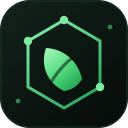
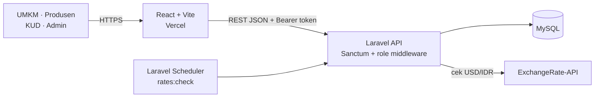

<div align="center">
  
  <h1>🌾 LokalChain</h1>
  <p><strong>DSS pemasok bahan baku lokal untuk UMKM: terdekat, termurah, dan sadar kurs.</strong></p>
  <p><em>Dari pergerakan USD/IDR menjadi keputusan pengadaan yang lebih tenang.</em></p>

  <p>
    <a href="#-tentang-lokalchain">Tentang</a> •
    <a href="#-fitur-utama">Fitur</a> •
    <a href="#-cara-kerja--algoritma">Algoritma</a> •
    <a href="#️-arsitektur--teknologi">Arsitektur</a> •
    <a href="#️-keamanan">Keamanan</a> •
    <a href="#-instalasi-lokal">Instalasi</a> •
    <a href="#-akun--data-demo">Akun Demo</a>
  </p>

  <p>
    <a href="https://laravel.com"></a>
    <a href="https://react.dev"></a>
    <a href="https://www.mysql.com"></a>
    <a href="https://vercel.com"></a>
    <a href="https://railway.app"></a>
  </p>

  <p>
    <a href="https://github.com/agnigaluhev-svg/lokalchain-api"></a>
    <a href="https://www.linkedin.com/in/agnigaluhev"></a>
    <a href="https://lokalchain-api.vercel.app/"></a>
  </p>
</div>

---

## 📖 Tentang LokalChain

**LokalChain** adalah sistem pendukung keputusan (DSS) untuk UMKM pangan yang ingin mendapatkan bahan baku dari produsen lokal. Saat rupiah melemah, harga bahan baku impor ikut naik; LokalChain membantu menemukan produsen **tervalidasi** yang paling efisien berdasarkan harga, jarak, dan kesegaran data.

Proyek ini dibuat untuk **NSEC 2026**. Fokusnya bukan menambah sebanyak mungkin fitur, tetapi membangun satu alur yang utuh: dari pemantauan kurs, pencarian pemasok, hingga keputusan pengadaan yang bisa dipertanggungjawabkan. Perhitungannya sengaja transparan dan **tidak memakai ML/AI**.

> **Status:** prototipe kompetisi. Produsen contoh adalah data simulasi dan harga impor adalah angka referensi/asumsi. Detailnya ada di [Transparansi Data](#️-transparansi-data).

---

## ✨ Fitur Utama

<p align="center"><strong>EKOSISTEM LOKALCHAIN</strong></p>

| 🌾 Rekomendasi | 📉 Kurs & Krisis | 🗺️ Peta & Jarak |
|:---:|:---:|:---:|
| Pemasok terdekat & termurah | Cek USD/IDR tiap 6 jam | Haversine, estimasi garis lurus |
| 📊 Analitik | 🏪 Portal Produsen | 🛡️ Akses per Peran |
| Impor vs lokal | Harga, stok, validasi KUD | Ditegakkan di server |

1. **🌾 Rekomendasi pemasok terdekat & termurah**
   - Memfilter hanya produsen yang sudah divalidasi KUD.
   - Menghitung total biaya dari harga barang, jumlah kebutuhan, dan estimasi ongkos jarak.
   - Menampilkan ranking, harga per kg, stok, jarak, dan status kesegaran data.

2. **📉 Pemantauan kurs USD/IDR + mode krisis**
   - Laravel Scheduler mengecek kurs setiap **6 jam**.
   - Status **krisis** aktif bila rupiah melemah **≥ 3%** dibanding baseline sekitar 7 hari.
   - Dashboard menampilkan kurs terbaru, perubahan, tren, dan status normal/krisis.

3. **🗺️ Peta skematik & estimasi jarak**
   - Visualisasi posisi UMKM dan pemasok dari koordinat.
   - Jarak memakai **Haversine** (garis lurus), dengan estimasi waktu kasar 2 menit/km.
   - Bukan basemap dan bukan mesin rute jalan.

4. **📊 Analitik dampak pengadaan**
   - Membandingkan harga lokal terbaik dengan **harga impor referensi**.
   - Menghitung potensi penghematan bulanan dan tahunan berdasarkan volume.
   - Menandai produsen yang datanya sudah lebih dari 7 hari.

5. **🏪 Portal produsen & validasi berjenjang**
   - Produsen melengkapi profil usaha, produk, harga, dan stok.
   - Produk tampil sebagai belum tervalidasi sampai disetujui KUD.
   - KUD dapat menyetujui atau mencabut validasi.

6. **🛡️ Akses per peran di sisi server**
   - `admin`, `kud`, `produsen`, dan `umkm` memiliki batas akses berbeda.
   - Middleware peran dan policy kepemilikan mencegah akses lintas data.
   - Menyembunyikan tombol di UI bukan satu-satunya kontrol.

### Akses per peran

| Peran | Yang bisa dilakukan |
|---|---|
| **Publik** | Registrasi `produsen`/`umkm`, login, melihat komoditas, kurs terbaru, dan riwayat kurs. |
| **UMKM** | Memilih sektor, melihat kurs, mencari rekomendasi, membuka daftar pemasok, peta, dan analitik. |
| **Produsen** | Mengelola profil usaha dan produk miliknya, memperbarui harga/stok. |
| **KUD** | Melihat produsen serta menyetujui/mencabut validasi. |
| **Admin** | Melihat pengguna, membuat akun KUD, mengaktifkan/menonaktifkan akun. |

---

## 🧮 Cara Kerja & Algoritma

### Alur singkat

1. UMKM memilih komoditas, jumlah kebutuhan, dan lokasi.
2. API mengambil produsen tervalidasi yang menjual komoditas tersebut.
3. Jarak dihitung dengan Haversine, lalu kandidat diurutkan berdasarkan total biaya.
4. UMKM melihat ranking, peta, dan kalkulator penghematan.
5. Scheduler memantau kurs dan mengubah status menjadi krisis bila ambang terlampaui.

### Rumus yang dipakai

```text
Jarak        d = 2R · asin(√(sin²(Δφ/2) + cosφ₁ · cosφ₂ · sin²(Δλ/2)))
             R = 6.371 km

Total biaya  total_cost = (harga_per_kg × qty) + (jarak_km × Rp2.000)

Penalti      total_cost × 1,15  jika data produsen > 7 hari tidak diperbarui

Estimasi     est_minutes = jarak_km × 2

Krisis       change_percent = ((kurs_sekarang − baseline) / baseline) × 100
             krisis jika change_percent ≥ 3%
```

**Catatan algoritma:**

- **Greedy ranking**, bukan solver global: kandidat diurutkan naik berdasarkan `total_cost`, lalu diambil maksimal 20 teratas.
- **Haversine**, bukan Dijkstra: jarak adalah garis lurus, bukan rute jalan.
- **Baseline kurs**: log paling baru yang umurnya ≥ 7 hari; jika belum ada, dipakai log tertua.
- **Harga impor tidak dipakai dalam ranking.** Nilainya hanya referensi untuk perbandingan di UI.

---

## 🏗️ Arsitektur & Teknologi



- **Backend**: [Laravel 13](https://laravel.com) API-only, PHP 8.3+, Laravel Sanctum, Laravel Scheduler.
- **Frontend**: [React 19](https://react.dev) + [Vite 8](https://vite.dev), CSS, `fetch` API.
- **Database**: MySQL 8.
- **Integrasi**: [ExchangeRate-API](https://www.exchangerate-api.com/) untuk kurs USD → IDR.
- **Deployment**: Vercel (frontend) dan Railway (backend).
- **Dokumentasi**: Mermaid untuk diagram, Markdown untuk arsitektur dan matriks akses.

Alur data lengkap, ERD, dan matriks akses ada di [`docs/ARSITEKTUR.md`](docs/ARSITEKTUR.md).

---

## 🛡️ Keamanan

1. **Autentikasi token** — Laravel Sanctum dengan masa berlaku default **7 hari** (`SANCTUM_TOKEN_EXPIRATION_MINUTES=10080`).
2. **Otorisasi per peran** — middleware `role` menolak request yang tidak sesuai peran, bukan hanya menyembunyikan UI.
3. **Policy kepemilikan** — produsen hanya dapat mengubah produk miliknya; KUD saja yang boleh mengubah validasi.
4. **Pembatasan percobaan** — login/registrasi `throttle:10,1`, cek kurs manual `throttle:6,1`.
5. **Akun nonaktif** — ditolak saat login dan seluruh tokennya dicabut saat dinonaktifkan.
6. **CORS terbatas** — origin diatur lewat `CORS_ALLOWED_ORIGINS`, bukan wildcard produksi.

> Token disimpan di `localStorage` pada frontend. Untuk produksi jangka panjang, cookie `HttpOnly` + SameSite atau rotasi token lebih aman.

---

## 📸 Screenshot

> Screenshot asli **belum tersedia** di repo ini. Tidak ada mockup palsu yang disertakan. Tambahkan file berikut ke [`docs/screenshots/`](docs/screenshots/); panduan pengambilan ada di [`docs/screenshots/README.md`](docs/screenshots/README.md).

| Tampilan | File |
|---|---|
| Pemilihan sektor | [`01-pilih-sektor.png`](docs/screenshots/01-pilih-sektor.png) |
| Beranda — kartu kurs & mode krisis | [`02-beranda-kurs.png`](docs/screenshots/02-beranda-kurs.png) |
| Daftar pemasok + ranking | [`03-daftar-pemasok.png`](docs/screenshots/03-daftar-pemasok.png) |
| Peta skematik pemasok | [`04-peta.png`](docs/screenshots/04-peta.png) |
| Analitik & kalkulator penghematan | [`05-analitik.png`](docs/screenshots/05-analitik.png) |
| Portal produsen | [`06-portal-produsen.png`](docs/screenshots/06-portal-produsen.png) |

---

## 🚀 Instalasi Lokal

### Prasyarat

- PHP **8.3+** dan Composer
- MySQL **8**
- Node.js **20+**
- API key [ExchangeRate-API](https://www.exchangerate-api.com/)

### Langkah-langkah

1. **Kloning repositori**

   ```bash
   git clone https://github.com/agnigaluhev-svg/lokalchain-api.git
   cd lokalchain-api
   ```

2. **Instal dependensi backend**

   ```bash
   composer install
   cp .env.example .env       # Windows: copy .env.example .env
   php artisan key:generate
   ```

3. **Konfigurasi `.env`**

   Sesuaikan MySQL dan integrasi kurs. Contoh **placeholder** — jangan commit file `.env`:

   ```dotenv
   APP_NAME=LokalChain
   APP_ENV=local
   APP_DEBUG=true
   APP_URL=http://127.0.0.1:8000

   DB_CONNECTION=mysql
   DB_HOST=127.0.0.1
   DB_PORT=3306
   DB_DATABASE=lokalchain
   DB_USERNAME=root
   DB_PASSWORD=

   EXCHANGE_RATE_API_KEY=your_api_key_here
   CORS_ALLOWED_ORIGINS=http://localhost:5173
   SANCTUM_TOKEN_EXPIRATION_MINUTES=10080

   ADMIN_NAME=Nama Admin
   ADMIN_EMAIL=admin@example.com
   ADMIN_PASSWORD=password_awal_yang_kuat
   ```

4. **Siapkan database dan data simulasi**

   ```bash
   php artisan migrate
   php artisan db:seed
   php artisan db:seed --class=AdminSeeder
   php artisan rates:check
   ```

5. **Jalankan backend**

   ```bash
   php artisan serve
   php artisan schedule:work   # terminal terpisah
   ```

   API berjalan di `http://127.0.0.1:8000`.

6. **Jalankan frontend**

   ```bash
   cd frontend
   cp .env.example .env        # Windows: copy .env.example .env
   npm install
   npm run dev
   ```

   Buka `http://localhost:5173`.

### Demo live

Aplikasi sudah dapat dicoba di:

**🌐 [https://lokalchain-api.vercel.app/](https://lokalchain-api.vercel.app/)**

> Demo memakai data produsen **simulasi** dan harga impor **referensi/asumsi**. Jika halaman gagal memuat data, tunggu beberapa saat lalu muat ulang — layanan backend dapat sedang cold start.

---

## 🔑 Akun & Data Demo

Tidak ada password default yang di-commit ke repositori. Akun disiapkan seperti ini:

| Peran | Cara mendapatkan akses | Hak akses utama |
|---|---|---|
| **Admin** | Jalankan `php artisan db:seed --class=AdminSeeder` dengan `ADMIN_*` di `.env`. | Kelola pengguna dan akun KUD. |
| **KUD** | Dibuat oleh admin melalui Panel Admin. | Validasi/cabut validasi produsen. |
| **Produsen** | Registrasi publik, lalu lengkapi profil usaha. | Kelola profil, harga, dan stok miliknya. |
| **UMKM** | Registrasi publik. | Cari rekomendasi dan analitik pengadaan. |

**Data seed:** 6 produsen **simulasi** di Malang, 1 di antaranya belum tervalidasi. Komoditas yang tersedia: Kedelai dan Gandum.

---

## ⚠️ Transparansi Data

| Klaim | Kenyataan di kode |
|---|---|
| Harga impor | **Asumsi/referensi** pada tabel komoditas, bukan data pasar nyata. |
| Jarak | **Haversine (garis lurus)**, bukan Dijkstra/rute jalan. Estimasi waktu kasar. |
| Produsen contoh | **Data simulasi** dari seeder. |
| KYC (KTP/selfie) | **Belum dibuat.** |
| ML/AI | **Tidak ada.** Ranking memakai aritmetika dan pengurutan. |
| Tombol “Hubungi Pemasok” | Nonaktif karena respons rekomendasi belum memuat nomor telepon. |
| Peta | Visualisasi skematik SVG, bukan basemap/navigasi rute. |
| Sektor | Hanya **Pangan/Kuliner** yang aktif; Tekstil/Kriya belum diisi. |
| Tes otomatis | Masih minim; matriks akses diuji manual. |
| Ganti password wajib KUD | Belum tersedia. |

### Rencana lanjutan

- KYC produsen dan audit log validasi KUD.
- Nomor telepon pada respons rekomendasi + integrasi WhatsApp yang benar-benar aktif.
- Peta nyata dan perbandingan rute jalan tanpa mengklaim Haversine sebagai rute.
- Pipeline harga impor dengan sumber resmi dan tanggal pembaruan.
- Feature test untuk seluruh matriks akses, termasuk akun nonaktif.
- Hardening produksi: cookie `HttpOnly`, rotasi token, rate limit global, observability.
- Dukungan sektor Tekstil dan Kriya setelah data tersedia.

---

<div align="center">
  <p>© 2026 <strong>LokalChain</strong> — menghubungkan dapur UMKM dengan produsen di sekitarnya.</p>
  <p>Dibuat oleh <a href="https://www.linkedin.com/in/agnigaluhev"><strong>Agni Galuh Essa Vandriya</strong></a> · <a href="https://github.com/agnigaluhev-svg">GitHub</a> · <a href="LICENSE">MIT License</a></p>
</div>
