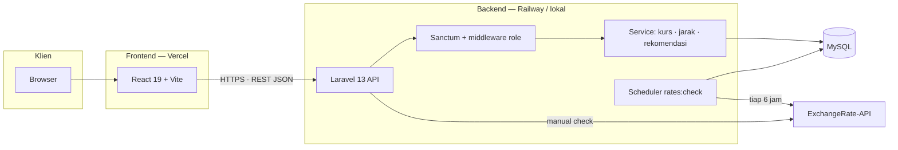
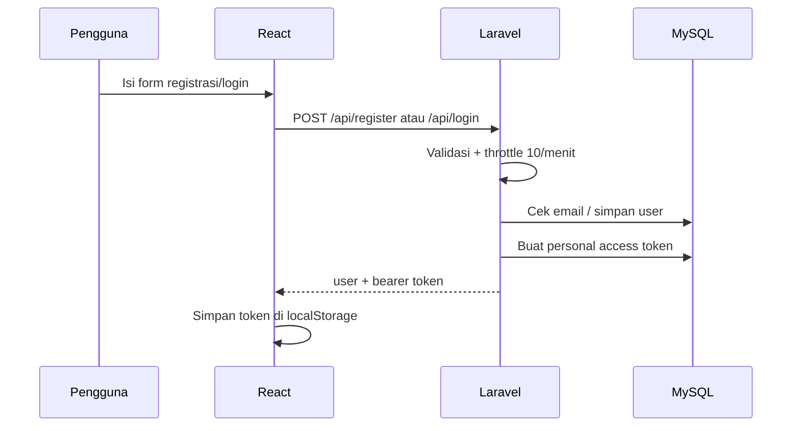
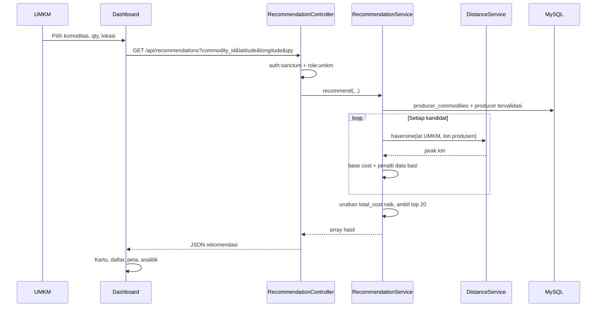
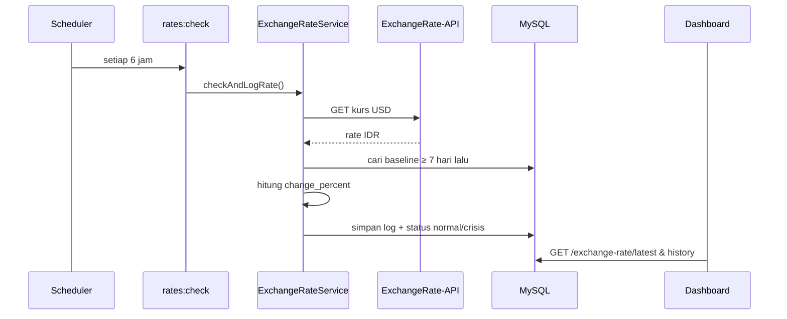
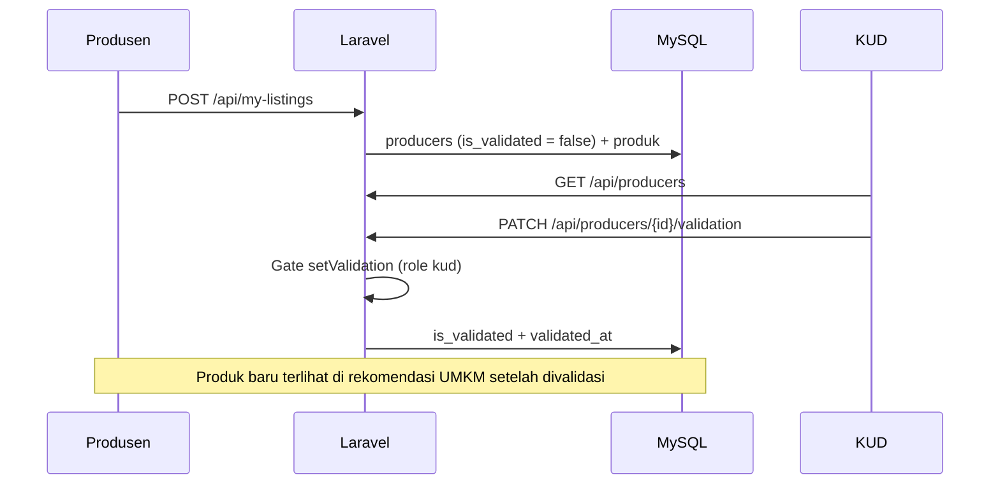
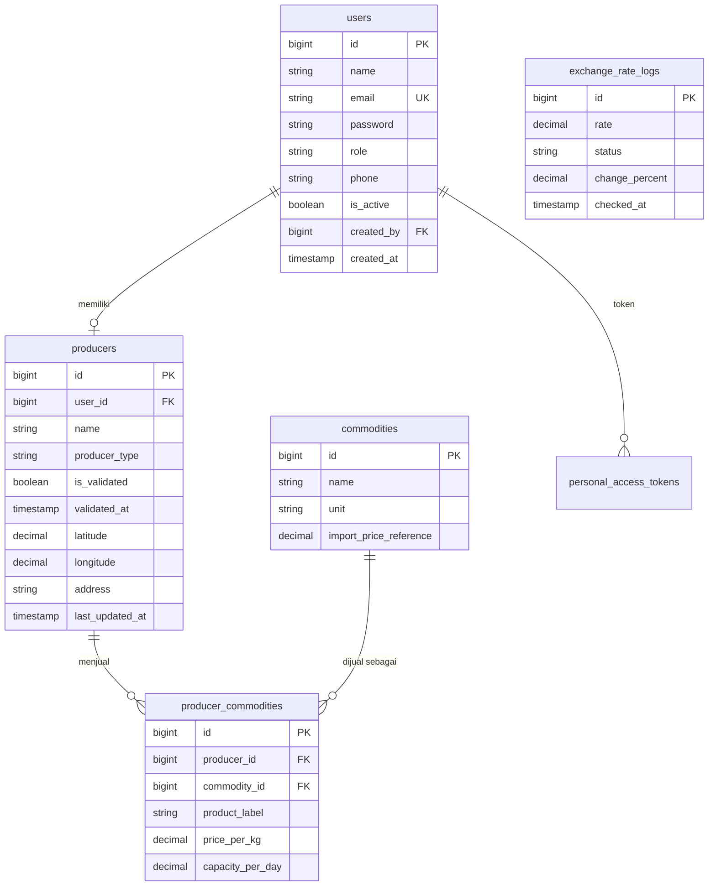

# Arsitektur LokalChain

Dokumen ini menjelaskan alur data, tabel utama, dan matriks akses yang benar-benar ada di kode. Jika sebuah fitur belum ada, fitur tersebut tidak dicantumkan sebagai bagian dari arsitektur.

---

## 1. Gambaran komponen



- **Frontend** tidak menyimpan data bisnis; seluruh keputusan akses dan perhitungan dilakukan di API.
- **Backend** bersifat API-only. Tidak ada rendering Blade untuk aplikasi utama.
- **ExchangeRate-API** adalah satu-satunya layanan eksternal yang dipanggil, yaitu untuk kurs USD → IDR.

---

## 2. Alur data

### 2.1 Registrasi dan login



- Registrasi publik hanya menerima peran `produsen` dan `umkm`.
- Akun `kud` hanya dibuat admin. Akun `admin` hanya dibuat lewat `AdminSeeder`.
- Saat login, akun dengan `is_active = false` ditolak.

### 2.2 Permintaan rekomendasi (UMKM)



Detail perhitungan:

```text
jarak_km      = haversine(lokasi_umkm, lokasi_produsen)
base_cost     = harga_per_kg × qty + jarak_km × 2.000
is_stale      = last_updated_at > 7 hari
total_cost    = base_cost × 1,15 jika is_stale, selain itu base_cost
est_minutes   = jarak_km × 2
ranking       = urutkan total_cost menaik
```

Catatan penting:

- Hanya produsen dengan `is_validated = true` yang masuk kandidat (default service).
- Ini **bukan** optimasi rute. Tidak ada Dijkstra, graph jalan, atau urutan kunjungan.
- `import_price_reference` hanya dipakai frontend untuk perbandingan harga; tidak memengaruhi ranking.

### 2.3 Pemantauan kurs dan mode krisis



- Status `crisis` hanya jika `change_percent >= 3.0`.
- Baseline: log paling baru yang umurnya **≥ 7 hari**; fallback ke log tertua.
- Penguatan rupiah tidak memicu krisis.
- Dashboard memuat ulang kurs tiap **5 menit**; tombol refresh memanggil `GET /api/exchange-rate/check` (wajib login, throttle 6/menit).

### 2.4 Validasi produsen



Produsen juga dapat memperbarui harga/stok lewat `PUT /api/producer-commodities/{id}`. Policy memastikan baris tersebut milik produsen yang sedang login, dan `last_updated_at` diperbarui agar tidak terkena penalti data basi.

---

## 3. Tabel utama



| Tabel | Kolom penting | Keterangan |
|---|---|---|
| `users` | `role`, `is_active`, `created_by` | Peran: `admin`, `kud`, `produsen`, `umkm`. `created_by` menandai akun KUD buatan admin. |
| `commodities` | `name`, `unit`, `import_price_reference` | `import_price_reference` adalah **asumsi/referensi**, bukan harga pasar live. |
| `producers` | `user_id`, `is_validated`, `validated_at`, `latitude`, `longitude`, `last_updated_at` | Satu akun produsen memiliki satu profil usaha. Koordinat dipakai Haversine. |
| `producer_commodities` | `price_per_kg`, `capacity_per_day`, `product_label` | Harga dan stok per produk. `capacity_per_day = 0` dianggap stok habis. |
| `exchange_rate_logs` | `rate`, `status`, `change_percent`, `checked_at` | Riwayat kurs untuk kartu, grafik, dan penentuan krisis. |
| `personal_access_tokens` | `tokenable_id`, `expires_at` | Tabel bawaan Sanctum untuk bearer token. |

---

## 4. Matriks akses peran

### 4.1 Endpoint API

| Metode & path | Publik | UMKM | Produsen | KUD | Admin | Kontrol tambahan |
|---|:---:|:---:|:---:|:---:|:---:|---|
| `POST /api/register` | ✅ | — | — | — | — | Hanya peran `produsen`/`umkm`; throttle 10/menit |
| `POST /api/login` | ✅ | ✅ | ✅ | ✅ | ✅ | Throttle 10/menit; akun nonaktif ditolak |
| `GET /api/commodities` | ✅ | ✅ | ✅ | ✅ | ✅ | Data referensi |
| `GET /api/exchange-rate/latest` | ✅ | ✅ | ✅ | ✅ | ✅ | 404 jika belum ada log |
| `GET /api/exchange-rate/history` | ✅ | ✅ | ✅ | ✅ | ✅ | Maksimal 30 log terakhir |
| `POST /api/logout` | — | ✅ | ✅ | ✅ | ✅ | `auth:sanctum`; hapus token aktif |
| `GET /api/me` | — | ✅ | ✅ | ✅ | ✅ | `auth:sanctum` |
| `GET /api/exchange-rate/check` | — | ✅ | ✅ | ✅ | ✅ | `auth:sanctum`; throttle 6/menit |
| `GET /api/recommendations` | — | ✅ | — | — | — | `role:umkm` |
| `GET /api/my-listings` | — | — | ✅ | — | — | `role:produsen`; filter `user_id` |
| `POST /api/my-listings` | — | — | ✅ | — | — | `role:produsen`; status awal belum validasi |
| `PUT /api/producer-commodities/{id}` | — | — | ✅ | — | — | `role:produsen` + policy kepemilikan |
| `GET /api/producers` | — | — | — | ✅ | ✅ | `role:kud,admin` |
| `PATCH /api/producers/{id}/validation` | — | — | — | ✅ | — | `role:kud` + policy |
| `GET /api/admin/users` | — | — | — | — | ✅ | `role:admin` |
| `POST /api/admin/kud-accounts` | — | — | — | — | ✅ | `role:admin`; satu-satunya jalur buat KUD |
| `PATCH /api/admin/users/{id}/active` | — | — | — | — | ✅ | `role:admin`; tidak bisa menonaktifkan diri sendiri/admin lain |

Legenda: ✅ = diizinkan, — = ditolak oleh middleware/policy.

### 4.2 Tampilan frontend

| Tampilan | UMKM | Produsen | KUD | Admin |
|---|:---:|:---:|:---:|:---:|
| Pilih sektor + dashboard | ✅ | — | — | — |
| Portal produsen | — | ✅ | — | — |
| Panel validasi produsen | — | — | ✅ | — |
| Panel pengguna & akun KUD | — | — | — | ✅ |

Pemisahan ini bukan pengganti keamanan: UI hanya mengarahkan pengalaman, sedangkan penolakan request tetap terjadi di server.

---

## 5. Keputusan desain

1. **Server sebagai sumber kebenaran.** Menyembunyikan tombol di UI tidak dianggap kontrol keamanan.
2. **Row-level filter untuk produsen.** `my-listings` memakai `whereHas('producer', user_id = user)`, bukan hanya menyembunyikan data di frontend.
3. **Validasi berjenjang.** Produsen mendaftar sendiri, tetapi hanya KUD yang dapat memberi atau mencabut validasi.
4. **Akun KUD tidak bisa didaftarkan publik.** Admin membuat akun untuk petugas badan resmi.
5. **Token tanpa cookie.** Sanctum bearer token disimpan di `localStorage`; ini sederhana untuk demo, tetapi memiliki trade-off keamanan yang dicatat di README.
6. **Perhitungan transparan.** Harga, jarak, penalti, dan estimasi waktu dikembalikan sebagai field eksplisit agar bisa diaudit.
7. **Integrasi eksternal minimal.** Hanya kurs yang diambil dari API pihak ketiga; tidak ada scraping harga atau layanan AI.

---

## 6. Batasan arsitektur

- Tidak ada antrean/worker terpisah; pengecekan kurs memakai scheduler Laravel.
- Tidak ada cache khusus untuk hasil rekomendasi; query dijalankan ulang per permintaan.
- Tidak ada layanan peta/rute. Peta frontend adalah proyeksi SVG dari koordinat.
- Endpoint rekomendasi belum mengirim nomor telepon, sehingga aksi “Hubungi Pemasok” nonaktif.
- Belum ada KYC, audit log validasi, atau automated test suite yang lengkap.
- Skala data saat ini kecil (6 produsen simulasi); belum ada pengujian beban.
